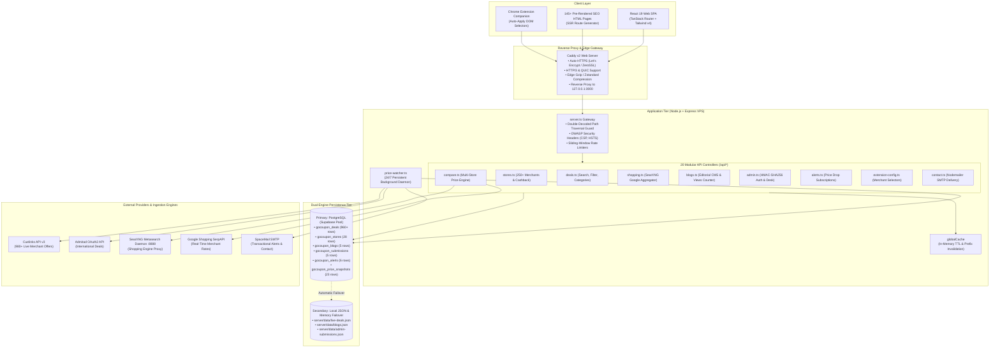

# GoCoupon: System Architecture & Technical Specification

> **The Sovereign Commerce Intelligence Engine: Multi-Store Cross-Comparison, 24/7 Verified Deal Ingestion, Dual-Engine Persistence, and Automated Bank Card Arbitrage.**

---

## 1. High-Level System Architecture

GoCoupon is built as a **persistent three-tier web platform** with an accompanying **browser extension**. It completely bypasses serverless cold starts by running on a dedicated Node.js + Express VPS server behind a high-performance Caddy reverse proxy.



---

## 2. The Dual-Engine Database Architecture (Zero-Downtime Guarantee)

A critical weakness of traditional single-database web apps is that cloud maintenance, cold starts, or network timeouts immediately cause HTTP 500 crashes.

GoCoupon solves this through a **Transparent Dual-Engine Persistence Model**:

```
                              ┌────────────────────────┐
                              │     Incoming Query     │
                              └───────────┬────────────┘
                                          │
                                          ▼
                         ┌─────────────────────────────────┐
                         │   queryPg() Safe Query Layer    │
                         └────────────────┬────────────────┘
                                          │
                  ┌───────────────────────┴───────────────────────┐
                  │ (Try Primary)                                 │ (On Error / Unreachable)
                  ▼                                               ▼
     ┌───────────────────────────┐                   ┌───────────────────────────┐
     │  PostgreSQL (Supabase)    │                   │   Local JSON & Memory     │
     │  Connection Pool (pg)     │                   │   Transparent Failover    │
     │  Max: 10, Timeout: 6000ms │                   │   server/data/*.json      │
     └───────────────────────────┘                   └───────────────────────────┘
```

1. **Primary Cloud Engine**: Managed PostgreSQL via Supabase connection pool (`pg.Pool`).
   - Supports relational integrity, transactions, and foreign keys across 6 core tables.
   - Batch upserts deals using `ON CONFLICT (id) DO UPDATE`.
2. **Secondary Local Engine**: Transparent local file-backed JSON (`live-deals.json`, `blogs.json`, `admin-submissions.json`) and memory cache.
   - If PostgreSQL is momentarily paused or unreachable, `queryPg()` catches the network exception, marks the engine as degraded, and immediately returns the cached disk/memory records.
   - User-facing requests never encounter an uncaught 500 error.

---

## 3. The 4-Tier Instant Stacking & Landed Cost Formula

Unlike superficial coupon sites that only display a single promo code, GoCoupon calculates the **True Net Landed Cost** across four simultaneous layers:

$$\mathbf{True\ Net\ Landed\ Price} = \mathbf{Sticker\ Price} - \mathbf{CouponSavings} - \mathbf{BankCardRebate} - \mathbf{Cashback} + \mathbf{Shipping}$$

```
┌─────────────────────────────────────────────────────────────────────────────┐
│ 1. Base Sticker Price (Scraped live via SearXNG / Google Shopping / SerpAPI) │
│    e.g. Sony WH-1000XM5 on Amazon IN = ₹29,990                              │
├─────────────────────────────────────────────────────────────────────────────┤
│ 2. Minus: Best Working Store Promo Code (Cuelinks / Admitad feed)            │
│    Applied Coupon 'AMZAUDIO15' = -₹1,500                                    │
├─────────────────────────────────────────────────────────────────────────────┤
│ 3. Minus: Instant Bank Card Discount (Card Arbitrage Matrix)                │
│    HDFC / SBI / ICICI Credit Card Instant 10% = -₹2,849                     │
├─────────────────────────────────────────────────────────────────────────────┤
│ 4. Minus: Verified Cashback (Affiliate Commission Kickback)                  │
│    Instant Cashback Kickback = -₹500                                        │
├─────────────────────────────────────────────────────────────────────────────┤
│ 5. Plus: Landed Shipping & Handling Fees                                    │
│    Standard Prime Delivery = +₹0                                            │
├─────────────────────────────────────────────────────────────────────────────┤
│ = TRUE NET LANDED COST: ₹25,141 (Total Savings: ₹4,849 / 16.2% Saved)        │
└─────────────────────────────────────────────────────────────────────────────┘
```

---

## 4. Price Intelligence & Outlier Elimination Algorithm

When querying multi-store aggregators for a product (e.g. *"MacBook Air M2"* or *"Sony WH-1000XM5"*), raw search engines frequently return irrelevant low-priced accessories (e.g. a ₹49 charging cable or ₹199 silicone skin) as false "cheapest deals."

GoCoupon implements an **algorithmic outlier filter (`filterPriceOutliers`)**:

1. **Title Token Intersection**: Calculates the Jaccard similarity between the search query tokens and candidate product titles.
2. **Median Absolute Deviation (MAD)**: Computes the median candidate price $M$. Any offer below $0.35 \times M$ or above $3.0 \times M$ is flagged for outlier scrutiny.
3. **Negative Keyword Guard**: Filters out titles containing accessory keywords (`case`, `cable`, `strap`, `screen protector`, `adapter`, `cover`, `pouch`, `charger`) unless the original search query explicitly requested them.

---

## 5. 24/7 Background Sync & Ingestion Workers

Inside the persistent Node.js process, a background daemon (`server/workers/price-watcher.ts`) operates continuously:

- **Bootstrap Sequence**:
  - `T + 2s`: Bootstraps Cuelinks API v3 sync, loads deals memory pool, and caches campaigns.
  - `T + 10s`: Staggered bootstrap of Admitad international deals sync.
- **Continuous Cadence**:
  - **Every 15 minutes**: Syncs active Cuelinks deals, prunes expired promo codes (`end_date < NOW()`), and triggers PostgreSQL batch upserts.
  - **Every 60 minutes**: Runs an Admitad synchronization cycle for global deals.
  - **Dynamic Price Alert Monitor**: Evaluates active user target prices against historical snapshots and dispatches email notifications via Nodemailer SMTP.

---

## 6. Frontend Architecture (TanStack Router & Pre-rendering)

The client application is built with **React 19**, **Vite 7**, and **TanStack Router**:

1. **Type-Safe Routing**: All route transitions and parameter definitions are strictly typed at compile time.
2. **Pre-Rendering Build Pipeline (`scripts/generate-routes.js`)**:
   - During `npm run build`, a headless static generator creates **145+ standalone `.html` files** for top store pages (`/amazon-coupons`, `/flipkart-coupons`, etc.) and blog articles.
   - Crawlers receive fully populated HTML with Schema.org JSON-LD structured data.
3. **Client-Side SPA Hydration**: Once loaded, TanStack Router hydrates seamlessly for instant client-side transitions.

---

## 7. Chrome Extension Architecture

GoCoupon includes a companion browser extension for automatic coupon testing:

- **Manifest V3**: Compliant with the latest Chrome Web Store specifications.
- **Dynamic Selector Registry (`/api/extension/selectors.json`)**:
  - Checkout input and button DOM selectors are hosted dynamically on the backend.
  - When merchant websites update their checkout UI (e.g., changing input IDs), the extension receives updated selectors instantly without requiring a Chrome Web Store review cycle.
- **Local Isolation**: The extension never transmits user credit card information or personal browsing data.
