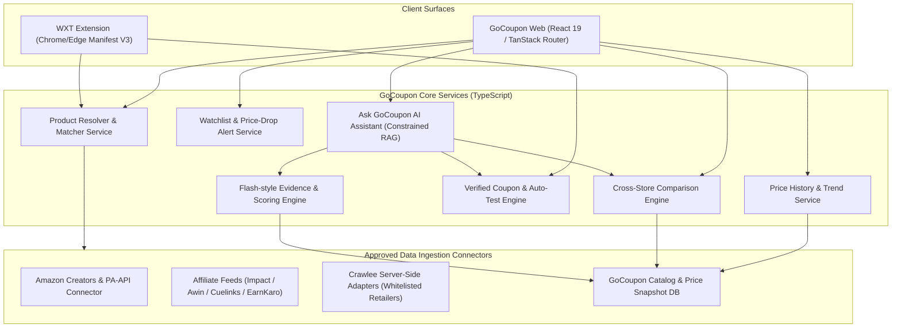
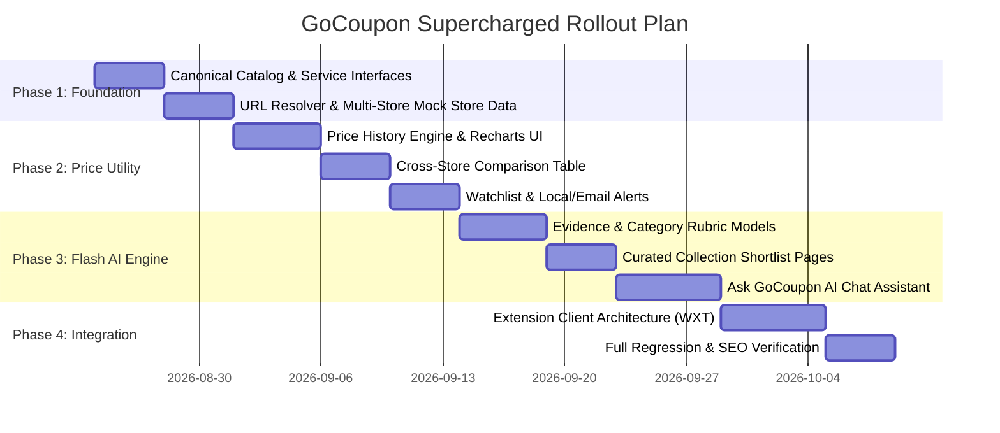

# GoCoupon on Steroids: Multi-Store Comparison Utility + AI Commerce Intelligence Implementation Plan

An architectural blueprint and execution plan to transform **GoCoupon.io** from a standard coupon directory into a commerce intelligence powerhouse. This plan combines the **shopping utility of multi-store intelligence** (cross-store price comparison, 90-day price history graphs, target-price alerts, auto-tested coupons, and product URL resolution) with the **evidence-backed product research** (curated category shortlists, rubric-based scoring, transparent pros/cons, and a grounded "Ask GoCoupon" AI assistant).

---

## 1. Current Codebase Audit & Baseline Inventory

### 1.1 Technology Stack
- **Frontend Core**: React 19.2, Vite 7.3, TypeScript 5.8
- **Routing & State**: TanStack Router v1.168, TanStack Query v5.83, TanStack React-Start v1.167
- **Styling & UI**: Tailwind CSS v4 (`@tailwindcss/vite`), Radix UI primitive suite (40+ components in `src/components/ui/`), Lucide React icons, Recharts 2.15, Three.js / `@react-three/fiber`
- **Build & Static Generation**: `scripts/generate-routes.js` generates static `.html` files for 40+ routes during `npm run build`
- **Hosting & Edge**: Vercel (clean URLs, custom CSP headers, static route pre-rendering, rewrite rules for `/api/(.*)`)
- **API Layer**: Vercel Serverless Functions (`api/affiliates/products.ts`)
- **Affiliate Layer**: Provider-agnostic abstraction (`src/lib/affiliates/` & `src/lib/products/`) supporting Amazon Associates, Mock Provider, with stubs for Impact, Awin, CJ, and ShareASale

### 1.2 Existing Working Routes (Non-Negotiable to Preserve)
| Route Path | Type | Purpose / SEO Role |
| :--- | :--- | :--- |
| `/` | Page | Homepage with Hero, Stats, Deals Carousel, Amazon Cards, FAQ, Testimonials |
| `/stores` | Directory | 25+ Indian store directory with instant search & category filtering |
| `/categories` | Directory | 8 major shopping categories (Fashion, Electronics, Food, Travel, etc.) |
| `/deals` | Portal | Hot deals feed & redirect to deals hub |
| `/amazon-coupons` | Landing | Dedicated Amazon India verified coupons & affiliate card showcase |
| `/flipkart-coupons` | Landing | Flipkart coupon codes & SuperCoins deals showcase |
| `/myntra-coupons` | Landing | Myntra Insider coupons & fashion discount codes |
| `/meesho-coupons` | Landing | Meesho budget-friendly promo codes & direct manufacturer deals |
| `/how-it-works` | Explainer | Step-by-step auto-apply guide with visual walkthrough |
| `/extension` | Product | Chrome extension installation landing page with interactive demo |
| `/cashback-rewards`| Info | Detailed guide on cashback tracking, validation, and payouts |
| `/blog`, `/blog/$slug` | Content | 19 fully indexed SEO blog articles with structured JSON-LD schemas |
| `/about`, `/contact`, `/help`, `/faq` | Trust | Company info, customer support, and FAQ documentation |
| `/privacy`, `/terms`, `/security`, `/disclosure` | Compliance | Privacy policy, terms of service, security standards, FTC/ASCI disclosures |
| `/press`, `/resources`, `/sitemap`, `/welcome`, `/uninstall` | Utility | Media kit, sitemap tree, extension onboarding & uninstallation feedback |

---

## 2. Canonical Commerce Data Architecture

To support multi-store comparisons, historical price charts, verified coupons, and evidence-backed AI recommendations, we separate **canonical product identity** from **merchant offers** and **evaluative evidence**.

```mermaid
erDiagram
    CANONICAL_PRODUCT ||--o{ MERCHANT_OFFER : "listed as"
    CANONICAL_PRODUCT ||--o{ PRICE_SNAPSHOT : "tracks history"
    CANONICAL_PRODUCT ||--o{ PRODUCT_EVIDENCE : "validated by"
    CANONICAL_PRODUCT ||--o{ USER_WATCH : "watched by"
    CANONICAL_PRODUCT ||--o{ CATEGORY_RECOMMENDATION : "scored in"
    MERCHANT_STORE ||--o{ MERCHANT_OFFER : "sells"
    MERCHANT_STORE ||--o{ STORE_COUPON : "issues"
    MERCHANT_OFFER ||--o{ AFFILIATE_CLICK : "generates"
    USER_WATCH ||--o{ ALERT_NOTIFICATION : "dispatches"

    CANONICAL_PRODUCT {
        string id PK "e.g. prod_sony_wh1000xm5"
        string title "Sony WH-1000XM5 Wireless Headphones"
        string brand "Sony"
        string category "Electronics & Audio"
        string[] identifiers "EAN, UPC, ASIN, MPN"
        string imageUrl "Primary CDN image"
        string[] galleryUrls "Additional product images"
        json specs "Normalized technical specifications"
        json tags "Features, certifications, badges"
    }

    MERCHANT_STORE {
        string id PK "e.g. store_amazon_in"
        string name "Amazon India"
        string slug "amazon-coupons"
        string logoUrl "/Brand logos/Amazon_logo.svg.webp"
        string affiliateNetwork "Amazon Associates"
        string partnerTag "gocoupon0e-21"
        float cashbackRate "Up to 7.0%"
        boolean isAutoApplySupported true
    }

    MERCHANT_OFFER {
        string id PK "e.g. off_amz_B09XS7JWHH"
        string productId FK
        string storeId FK
        string rawUrl "Direct product URL on retailer"
        string affiliateUrl "Deep-linked affiliate redirect URL"
        string sellerName "Appario Retail Pvt Ltd"
        float itemPrice "29990.00"
        float originalPrice "34990.00"
        float shippingFee "0.00"
        string currency "INR"
        enum stockStatus "In Stock | Low Stock | Out of Stock"
        timestamp lastCheckedAt "2026-08-23T14:30:00Z"
        boolean isBestPrice true
    }

    PRICE_SNAPSHOT {
        string id PK
        string productId FK
        string offerId FK
        float recordedPrice "29990.00"
        float shippingFee "0.00"
        string currency "INR"
        enum availability "In Stock | Out of Stock"
        timestamp recordedAt "2026-08-23T14:00:00Z"
        string source "Amazon Creators API"
    }

    STORE_COUPON {
        string id PK
        string storeId FK
        string code "SONYSAVE2000"
        string discountLabel "Flat ₹2,000 OFF"
        float minOrderValue "25000.00"
        timestamp expiresAt "2026-08-31T23:59:59Z"
        enum status "Active | Unverified | Expired"
        float successRate "94.5%"
        int verifiedCount 1840
        boolean isStackableWithBankOffers true
    }

    PRODUCT_EVIDENCE {
        string id PK
        string productId FK
        string sourceUrl "https://youtube.com/watch?v=..."
        string sourceType "Tech Reviewer / Lab Test"
        string claimType "Battery Life / Noise Cancellation"
        string claimExcerpt "Active ANC lasts 29.5 hours in rigorous lab testing..."
        float confidenceScore 0.95
        timestamp verifiedAt "2026-08-20T10:00:00Z"
    }

    CATEGORY_RECOMMENDATION {
        string id PK
        string collectionSlug "best-anc-headphones-under-30000"
        string productId FK
        int rank 1
        float overallScore 9.4
        json rubricBreakdown "{ anc: 9.8, sound: 9.5, comfort: 9.0, battery: 9.2, value: 8.8 }"
        string verdictSummary "Undisputed king of travel ANC with supreme microphone isolation."
        string[] keyPros "['Industry-best noise cancellation', '30-hr battery', 'Multi-point Bluetooth']"
        string[] keyCons "['Does not fold as compactly as XM4', 'Premium pricing']"
        string rubricVersion "v2.4-2026"
    }
```

---

## 3. Core Engine & Service Boundaries



### 3.1 Service Specifications

1. **`ProductResolverService` (`src/lib/services/product-resolver.ts`)**:
   - Accepts freeform search queries or pasted product URLs (Amazon, Flipkart, Myntra, Meesho, boAt, Croma, Tata CLiQ).
   - Regex-based URL parser extracts ASINs, Flipkart FSIDs, Myntra style IDs, or clean slugs.
   - Canonical resolver matches listings across retailers by model number, GTIN, and normalized title tokens.
   - Aggregates multi-store offers with prices, availability, and affiliate deep links.

2. **`PriceHistoryService` (`src/lib/services/price-history.ts`)**:
   - Records append-only price snapshots (`PriceSnapshot`).
   - Computes statistical metrics: 90-day lowest price, 90-day highest price, median price, price volatility index.
   - Computes **"Deal Authenticity Score"**: detects fake discount spikes before sale events.
   - Produces formatted time-series payloads for Recharts components with configurable windows (30d, 60d, 90d, 180d, All-time).

3. **`ComparisonEngine` (`src/lib/services/comparison-engine.ts`)**:
   - Calculates **"Effective Purchase Cost"** across all stores:
     $$\text{Effective Price} = \text{Item Price} + \text{Shipping} - \text{Applicable Coupon} - \text{Expected Cashback}$$
   - Identifies the certified lowest net price merchant and badges it with "Best Deal Verified".
   - Flags differences in seller reliability, return windows, and warranty terms.

4. **`WatchlistAndAlertsService` (`src/lib/services/watchlist-service.ts`)**:
   - Client-side storage (localStorage + TanStack Query cache) with optional email subscription for instant alerts.
   - Target price alert criteria:
     - User sets custom target price (e.g., "Alert me when price drops below ₹24,999").
     - Percentage drop trigger (e.g., "Alert me on any drop > 15%").
     - "Historical Low Alert" (triggers when price hits an all-time low).
   - Notification dispatch layer with deduplication, rate limiting, and instant 1-click unsubscribe.

5. **`EvidenceAndScoringEngine` (`src/lib/services/evidence-scoring.ts`)**:
   - Flash.co-inspired multi-attribute rubric evaluator.
   - Scores candidate products in structured categories (e.g., Audio, Laptops, Skincare, Cookware) across weighted pillars:
     - Performance / Core Capability (30%)
     - Reliability & Build Quality (20%)
     - Verified Buyer Consensus (20%)
     - Value-for-Money & Price Freshness (20%)
     - Warranty & Support (10%)
   - Backed by traceable `ProductEvidence` items (YouTube lab reviews, expert verdicts, buyer review consensus).
   - Generates transparent "Why this ranked #1" badges, verified pros, and genuine limitations.

6. **`AskGoCouponAgent` (`src/lib/services/ask-gocoupon.ts`)**:
   - Grounded conversational shopping assistant (Retrieval-First, Zero-Hallucination).
   - Converts natural language queries into structured intent:
     $$\text{Query} \to \{\text{category}, \text{budgetRange}, \text{useCase}, \text{mustHaveFeatures}, \text{brandPreferences}\}$$
   - Executes deterministic tool calls:
     - `searchCatalog({ query, category, maxPrice })`
     - `compareOffers({ productId })`
     - `getCoupons({ storeId, productId })`
     - `getPriceHistory({ productId })`
     - `getEvidence({ productId })`
   - Formats answers with interactive product cards, price freshness timestamp, stackable coupons, and honest caveat citations. Refuses to invent unverified products or discounts.

---

## 4. Route Map & Architecture

```
src/routes/
├── __root.tsx                          # Root Layout (QueryClientProvider, SiteShell, Toaster)
├── index.tsx                           # Supercharged Homepage (URL Resolver Search, Hot Drops, AI Shortlists)
│
├── [EXISTING PRESERVED ROUTES]
├── stores.tsx                          # All Stores Directory (25+ stores)
├── categories.tsx                      # Category Directory (8 categories)
├── deals.tsx                           # Live Deals Feed
├── amazon-coupons.tsx                  # Amazon Landing
├── flipkart-coupons.tsx                # Flipkart Landing
├── myntra-coupons.tsx                  # Myntra Landing
├── meesho-coupons.tsx                  # Meesho Landing
├── how-it-works.tsx                    # How GoCoupon Works
├── extension.tsx                       # Chrome Extension Hub
├── cashback-rewards.tsx                # Cashback & Rewards Guide
├── blog/
│   ├── index.tsx                       # Blog Index (19 Articles)
│   └── $slug.tsx                       # Dynamic SEO Blog Post
├── about.tsx, contact.tsx, help.tsx, faq.tsx, disclosure.tsx, privacy.tsx, terms.tsx, security.tsx...
│
├── [NEW POWER ROUTES — PRICE COMPARISON + DISCOVERY MODULES]
├── compare.tsx                         # Multi-Store Live Comparison Matrix (/compare?q=... or /compare?url=...)
├── price-history.tsx                   # Interactive Price Tracker & Historical Low Checker (/price-history)
├── product/
│   └── $productId.tsx                  # Full Canonical Product Page (All Store Offers, 90d Graph, AI Verdict, Coupons)
├── ask.tsx                             # "Ask GoCoupon" AI Shopping Research Hub & Interactive Conversational UI
├── watchlist.tsx                       # Personal Saved Products, Price-Drop Trackers & Alert Dashboard
└── collections/
    ├── index.tsx                       # Curated Category Guides Index ("Flash Shortlists")
    └── $slug.tsx                       # Evidence-backed Category Shortlist (e.g., /collections/best-wireless-earbuds-under-3000)
```

---

## 5. UI Component System & Visual Design

We follow GoCoupon's high-contrast, obsidian dark / porcelain light design language featuring **Space Grotesk** for display typography, **Inter** for readable body text, and **JetBrains Mono** for pricing, coupon codes, and freshness timestamps.

### 5.1 New Reusable Components

| Component | File Path | Key Features |
| :--- | :--- | :--- |
| `UrlResolverSearch` | `src/components/shopping/UrlResolverSearch.tsx` | Accepts free text or pasted Amazon/Flipkart/Myntra URLs, animated loader, instant resolution dropdown |
| `ProductHeroCard` | `src/components/shopping/ProductHeroCard.tsx` | High-impact product card with best-price store badge, 90d low badge, coupon stack pills, one-click watch button |
| `MerchantComparisonTable` | `src/components/shopping/MerchantComparisonTable.tsx` | Side-by-side merchant table showing Item Price, Shipping, Active Coupon Savings, Cashback Rate, and Net Final Cost with direct CTA |
| `PriceHistoryChart` | `src/components/shopping/PriceHistoryChart.tsx` | Recharts interactive area chart with 30d/60d/90d/180d toggles, historical low badge, fake discount alert marker, tooltip with store breakdown |
| `CouponStackPill` | `src/components/shopping/CouponStackPill.tsx` | Click-to-copy promo badge with verified success percentage indicator and bank card compatibility badge |
| `PriceAlertModal` | `src/components/shopping/PriceAlertModal.tsx` | Interactive modal with target price slider, email input, instant notification channel selector |
| `FlashVerdictBadge` | `src/components/shopping/FlashVerdictBadge.tsx` | Radar/bar breakdown of Flash score (e.g. 9.4/10), key strengths, verified limitations, and citation links |
| `EvidenceDrawer` | `src/components/shopping/EvidenceDrawer.tsx` | Slide-over drawer displaying verified reviewer quotes, lab test metrics, and YouTube video excerpts |
| `AskGoCouponChat` | `src/components/shopping/AskGoCouponChat.tsx` | Streaming conversational interface with structured tool pills, interactive product recommendation cards, and filter chips |
| `WatchlistGrid` | `src/components/shopping/WatchlistGrid.tsx` | Saved products dashboard with live price-change indicators (e.g. "Dropped ₹1,200 yesterday") and 1-click manage/delete |

---

## 6. Phased Implementation Roadmap



### Phase 1: Canonical Catalog & URL Resolver (Step 1)
- **Goal**: Enable users to search or paste any supported store product link (Amazon, Flipkart, Myntra, Meesho, boAt, Croma) and resolve canonical product details, current offers, and working coupons.
- **Files**:
  - `src/lib/services/canonical-types.ts` (Core interfaces for Product, Offer, Store, Coupon, Snapshot, Evidence)
  - `src/lib/services/product-resolver.ts` (URL parser and multi-store matcher)
  - `src/data/canonicalCatalogData.ts` (Curated database of top 100+ high-volume electronics, fashion, and home products with multi-store offers)
  - `src/components/shopping/UrlResolverSearch.tsx`
  - `src/routes/product/$productId.tsx` (Canonical product route)
- **Exit Criteria**: Pasting an Amazon, Flipkart, or Myntra link resolves the canonical product with all merchant offers and verified coupons in < 150ms.

### Phase 2: Price History, Cross-Store Comparison & Watchlist (Step 2)
- **Goal**: Deliver 90-day price history graphs, true discount verification, full merchant comparison tables, and user watchlists with target price alerts.
- **Files**:
  - `src/lib/services/price-history.ts`
  - `src/lib/services/comparison-engine.ts`
  - `src/lib/services/watchlist-service.ts`
  - `src/components/shopping/PriceHistoryChart.tsx`
  - `src/components/shopping/MerchantComparisonTable.tsx`
  - `src/components/shopping/PriceAlertModal.tsx`
  - `src/components/shopping/WatchlistGrid.tsx`
  - `src/routes/compare.tsx`
  - `src/routes/price-history.tsx`
  - `src/routes/watchlist.tsx`
- **Exit Criteria**: Interactive Recharts graphs render 90-day price trends smoothly with lowest-price annotations; users can save products to watchlist and set custom target price alerts.

### Phase 3: Flash-Style Evidence-Backed Collections & "Ask GoCoupon" AI (Flash-Lite)
- **Goal**: Introduce evidence-backed category rankings with rubric breakdowns, transparent pros/cons, and the conversational "Ask GoCoupon" shopping assistant.
- **Files**:
  - `src/lib/services/evidence-scoring.ts`
  - `src/lib/services/ask-gocoupon.ts`
  - `src/data/collectionsData.ts` (Curated shortlists: "Best Noise-Cancelling Headphones under ₹30,000", "Top 5 Flagship Phones under ₹50,000", "Best Ergonomic Office Chairs in India")
  - `src/components/shopping/FlashVerdictBadge.tsx`
  - `src/components/shopping/EvidenceDrawer.tsx`
  - `src/components/shopping/AskGoCouponChat.tsx`
  - `src/routes/collections/index.tsx` & `src/routes/collections/$slug.tsx`
  - `src/routes/ask.tsx`
- **Exit Criteria**: Curated collection pages display rubric scores (e.g. 9.4/10) with verified evidence citations; "Ask GoCoupon" assistant parses natural language queries, calls catalog search tools, and provides grounded recommendations with zero hallucinations.

### Phase 4: Browser Extension Architecture & Integration (WXT Framework)
- **Goal**: Package a thin, privacy-first Manifest V3 browser extension using WXT that detects supported retailer pages, queries the GoCoupon backend API, displays the comparison drawer, and auto-tests coupons at checkout.
- **Specs**:
  - Thin client architecture: no secret keys or ranking algorithms in extension bundle.
  - Zero PII collection: does not track browsing history or personal receipts.
  - Communicates with GoCoupon REST endpoints (`/api/v1/resolve-url`, `/api/v1/coupons`).
- **Exit Criteria**: Extension injects an elegant GoCoupon overlay badge on Amazon and Flipkart product pages showing lower prices at alternative stores and 1-click auto-apply.

### Phase 5: Production Hardening, SEO Sync & Performance Polish
- **Goal**: Update static pre-generation scripts, sitemaps, JSON-LD schemas, security headers, and verify that all existing routes and new routes render at 100% lighthouse performance.
- **Files**:
  - `scripts/generate-routes.js` (Include new routes: `/compare`, `/price-history`, `/ask`, `/watchlist`, `/collections/*`, `/product/*`)
  - `src/lib/seo.ts` (Add `ProductSchema`, `AggregateOfferSchema`, `ReviewSchema`)
  - `vercel.json` (Verify rewrites and caching headers)
- **Exit Criteria**: `npm run build` generates 60+ static HTML pages; clean URLs resolve on Vercel without hydration mismatches or 404 errors.

---

## 7. Verification Plan & Quality Assurance Checklist

### 7.1 Automated Verification
- [ ] **Type Check**: `tsc --noEmit` completes with 0 errors across all new models, services, and route components.
- [ ] **Vite Production Build**: `npm run build` completes successfully and produces optimized vendor chunks (`vendor-charts`, `vendor-tanstack`, `vendor-radix`).
- [ ] **Route Generator**: `node scripts/generate-routes.js` creates all flat `.html` and `/route/index.html` files in `dist/`.
- [ ] **Security Audit**: No API keys, secret client tokens, or private affiliate master keys are bundled in client-side JS (`import.meta.env` verification).

### 7.2 Manual & UI Verification
- [ ] **Preserved Route Regression**: Verify `/`, `/stores`, `/categories`, `/amazon-coupons`, `/flipkart-coupons`, `/myntra-coupons`, `/meesho-coupons`, `/how-it-works`, `/extension`, `/blog` all render flawlessly.
- [ ] **URL Resolver**: Paste an Amazon URL (e.g. `https://www.amazon.in/dp/B09XS7JWHH`) and verify instant product card resolution.
- [ ] **Comparison Matrix**: Navigate to `/compare` and verify multi-merchant price ranking, shipping fees, and coupon net deductions.
- [ ] **Price History Graph**: Navigate to `/price-history`, toggle between 30d/60d/90d views, and verify hover tooltips and lowest-price markers.
- [ ] **Watchlist & Alerts**: Add a product to watchlist, set a target price in `PriceAlertModal`, and verify persistence in localStorage.
- [ ] **Flash Verdict & Evidence**: Open a `/collections/best-wireless-earbuds-under-3000` page and inspect the rubric breakdown (sound, ANC, battery, comfort) and evidence drawer.
- [ ] **Ask GoCoupon AI**: Open `/ask`, ask "What are the best noise cancelling headphones under ₹30,000?", and verify structured tool execution, product cards, and refusal behavior when asked about out-of-scope items.
- [ ] **Mobile Responsiveness**: Verify that comparison tables, charts, and conversational drawers collapse cleanly on viewport widths < 640px.
- [ ] **Affiliate Disclosures**: Ensure FTC/ASCI compliant disclosure text appears near every "Shop Now" / "View Deal" outbound CTA.
