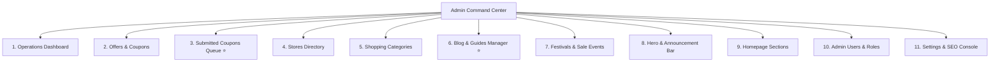

# GoCoupon.io — Complete Visitor & User Feature Inventory & Admin Management Analysis

This document provides an in-depth architectural breakdown of every feature available to visitors and users on **GoCoupon.io**, evaluates which features require active administrative control, and defines the blueprint for the upgraded GoCoupon Admin Suite (focusing especially on **Blog Management** and **Community Coupon Submissions**).

---

## 1. Visitor & User Features Inventory

| # | Feature Domain | Visitor / User Capabilities | Current Data Source | Admin Management Need | Priority |
|---|----------------|-----------------------------|---------------------|-----------------------|----------|
| **1** | **Live Coupon & Deal Discovery** | Browse 970+ live verified deals, copy discount promo codes, trigger auto-redirect affiliate links, filter by code vs deal, check expiration countdowns. | Cuelinks API v3 + Memory Pool + Disk Cache | **High**: Add manual deals, edit titles/links, prune expired, bulk import. | **Critical** |
| **2** | **Community Coupon Submission** | Submit unlisted coupons & discounts via `/submit-coupon` modal or standalone button. Fields: Store, Code, Discount, URL, Category, Terms, Expiry, Submitter Email. | `POST /api/deals/submit` -> `userSubmissionsPool` | **Highest**: Dedicated Review Desk to view queue, 1-click Approve to live feed, Reject with reason, or Edit. | **Critical** |
| **3** | **Editorial & Shopping Guides (Blog)** | Read shopping comparison articles, store savings guides, bank discount breakdowns, and competitor matrices (e.g. *GoCoupon vs GrabOn & CouponDuniya*). | `src/data/posts.ts` (Static records) | **Highest**: Full CRUD suite to create articles, edit markdown, manage categories, cover images, authors, read times, drafts/publishing, and SEO tags. | **Critical** |
| **4** | **Stores & Merchant Directory** | Browse 240+ brand profiles (Amazon, Flipkart, Myntra, Croma, Swiggy, etc.), view cashback rates, store FAQs, and trusted store badges. | `server/data/stores.json` + Cuelinks Merchants | **High**: Edit affiliate links, custom store descriptions, upload logos, set trust ratings, and add store FAQs. | **High** |
| **5** | **8 Primary Shopping Categories** | Filter deals by taxonomy: Electronics, Fashion, Beauty, Food, Travel, Home, Recharge, General. Displays store counts and max discounts. | Dynamic aggregation from active deals pool | **Medium**: Manage category names, slugs, icons, and hero descriptions. | **Important** |
| **6** | **Bank Card Arbitrage Hub** | Instant bank discount matrix (HDFC 10%, SBI Flat ₹1,500, ICICI Flat ₹2,000, Axis 5% Cashback) with minimum orders and max caps. | `server/routes/stack.ts` | **Medium**: Handled through bank offer cards / coupon rules. | **Important** |
| **7** | **Festivals & Sale Campaigns** | Dedicated festive sales (Diwali, Prime Day, Big Billion Days, Black Friday, Christmas, Eid, PayDay). | `server/data/events.json` | **High**: Create campaign landing pages, banner graphics, and target keywords. | **Important** |
| **8** | **Top Announcement Bar & Hero** | Sticky top announcement for sitewide flash alerts and hero promotional banner slides with search box. | `server/data/hero.json` & `settings.json` | **High**: Instant copy updates, link destinations, countdown triggers, and visibility toggles. | **High** |
| **9** | **Homepage Curated Sections** | Dynamic front-page layout: Trending Deals, Featured Stores, Savings Breakdown, and Trust Pillars. | `server/data/sections.json` | **Medium**: Re-order sections, toggle visibility, customize titles. | **Important** |
| **10** | **Admin Team & Roles** | Multi-role access control (Super Administrator, Content Editor, Read-Only Viewer) with granular permissions. | `server/data/users.json` | **High**: Invite editors, revoke tokens, assign specific tabs. | **High** |
| **11** | **Technical SEO & Sitemap** | Search engine crawlers indexing 145+ URLs, robots.txt, sitemap.xml, Schema.org JSON-LD. | Express static routes + `server/data/settings.json` | **High**: Edit robots.txt, refresh sitemap, verify Google/Bing tokens. | **High** |
| **12** | **User Contact & Inquiry Inbox** | Visitors submit contact requests, partnership inquiries, or store dispute feedback via `/contact`. | `POST /api/contact` -> `notifications.json` | **Medium**: Notifications bell in Topbar + admin view. | **Operational** |
| **13** | **Chrome Extension Portal** | Landing page for GoCoupon Auto Coupon Applier browser extension (`/extension`, `/chrome-extension`). | Static + Extension config | **Low**: Configured via static routes and app store links. | **Automated** |
| **14** | **Product Price Comparison** | Experimental multi-store price check across electronics & appliances (`/product/:id`, `/compare`). | Live API queries | **Low**: Aggregated dynamically; no continuous manual editing needed. | **Secondary** |

---

## 2. Streamlined Admin Architecture

To keep the Admin Panel uncluttered, intuitive, and focused strictly on high-impact administrative workflows, we retain **only important features** and promote **Submitted Coupons** and **Blog Management** to first-class modules:

### Features Kept & Prioritized
1. **Operations Dashboard (`/admin`)**: Real-time KPI cards (live deals, active promo codes, partner stores, platform sync health), 30-day activity trends chart, and quick shortcuts.
2. **Offers & Coupons (`/admin?tab=offers`)**: Full inventory management, active/expired tabs, search, manual creation, and bulk CSV/JSON importer.
3. **Submitted Coupons Review Desk (`/admin?tab=submissions`)** ⭐ *[NEW]*:
   - Live queue of community-submitted coupons from visitors.
   - Pending, Approved, and Rejected status tabs.
   - 1-Click "Approve to Live Feed" (automatically creates live offer and publishes).
   - "Edit & Approve" modal to refine coupon title, terms, or category before publishing.
   - "Reject" with customizable reason.
   - Real-time pending count badge in the sidebar.
4. **Stores Directory (`/admin?tab=stores`)**: Store URLs, affiliate link templates, logos, trust scores, and custom FAQ sections.
5. **Shopping Categories (`/admin?tab=categories`)**: 8 primary catalog categories, taxonomy slugs, and deal counts.
6. **Blog & Guides Manager (`/admin?tab=blogs`)** ⭐ *[UPGRADED]*:
   - Full CRUD backend connected to persistent storage (`server/data/blogs.json`), seeded from `src/data/posts.ts`.
   - Rich article creator with Title, Slug auto-generation, Excerpt, Markdown/HTML Content, Category, Cover Image, Author, Read Time, and Status (Published / Draft).
   - Instant live preview link to `/blog/:slug`.
   - Edit and delete existing comparison articles.
7. **Events & Festivals (`/admin?tab=events`)**: Seasonal sales (Diwali, Prime Day, Black Friday, Christmas) and keyword matching.
8. **Hero Banner & Announcement Bar (`/admin?tab=hero`)**: Top alert bar text, CTA button, countdown timer, and hero carousel slides.
9. **Homepage Showcase Sections (`/admin?tab=sections`)**: Re-order and toggle homepage blocks.
10. **Admin Users & Roles (`/admin?tab=users`)**: Manage administrator and editor accounts with role-based permissions.
11. **Settings & SEO Console (`/admin?tab=settings`)**: Robots.txt, sitemap.xml, site metadata, and verification codes.

### Features Streamlined Out of Primary Nav
- **Products & Prices tab**: Removed from the primary sidebar to reduce noise, since product deals are automatically ingested via Cuelinks and price comparison APIs without requiring routine manual CRUD.

---

## 3. Detailed Specifications for Target Upgrades

### A. Community Coupon Submission Review Desk
- **Frontend Component**: [`src/admin/components/AdminSubmissionsManager.jsx`](file:///e:/Gocoupon_web/gocoupon-magic/src/admin/components/AdminSubmissionsManager.jsx)
- **Features**:
  - Stat cards: Total Submissions, Pending Review (with pulse dot), Approved Live, Rejected.
  - Search filter by store name, promo code, or submitter email.
  - Table columns: Store Name, Promo Code (with copy button), Discount, Submitter Email, Submission Date, Current Status, Actions.
  - Action buttons:
    - `Quick Approve`: Instantly converts submission into an active `DealRecord` in memory & disk pool.
    - `Edit & Approve`: Allows adjusting code, discount text, or expiry date before inserting.
    - `Reject`: Updates status to `rejected` without polluting live feed.
    - `Delete`: Permanently removes spam submissions.
- **Backend Endpoints**:
  - `GET /api/admin/submissions` — Retrieve submissions with optional `status` filter.
  - `POST /api/admin/submissions/:id/approve` — Insert into live deals pool and mark approved.
  - `POST /api/admin/submissions/:id/reject` — Mark rejected.
  - `PUT /api/admin/submissions/:id` — Update submission fields.
  - `DELETE /api/admin/submissions/:id` — Delete submission.

### B. Full-Featured Blog & Guides Management System
- **Frontend Component**: [`src/admin/components/AdminBlogsManager.jsx`](file:///e:/Gocoupon_web/gocoupon-magic/src/admin/components/AdminBlogsManager.jsx)
- **Backend Router**: [`server/routes/blogs.ts`](file:///e:/Gocoupon_web/gocoupon-magic/server/routes/blogs.ts) (mounted at `/api/blogs` and `/api/admin/blogs`)
- **Features**:
  - Disk persistence in `server/data/blogs.json`, initialized with rich baseline posts from `src/data/posts.ts`.
  - Full CRUD operations:
    - `GET /api/blogs` — Public & admin list with category filtering.
    - `GET /api/blogs/:slug` — Individual article retrieval.
    - `POST /api/blogs` — Create new post with auto-slug generation.
    - `PUT /api/blogs/:slug` — Update title, content, image, category, status.
    - `DELETE /api/blogs/:slug` — Remove article.
  - Rich form fields: Title, URL Slug, Excerpt, Main Content (Markdown/HTML), Cover Image URL, Category, Author, Estimated Read Time, Status (`Published` vs `Draft`), and SEO Meta Description.
  - Live Action Button: Directly open the live published article at `/blog/{slug}` in a new tab.

---

## 4. Implementation Next Steps
1. Create `server/routes/blogs.ts` with persistent storage in `server/data/blogs.json` (seeded from `src/data/posts.ts`).
2. Add submission review endpoints in `server/routes/admin.ts` (`/api/admin/submissions`).
3. Build `src/admin/components/AdminSubmissionsManager.jsx`.
4. Upgrade `src/admin/components/AdminBlogsManager.jsx` with full backend sync and direct live preview.
5. Update `src/lib/access-control.ts`, `AdminSidebar.jsx`, and `src/routes/admin.tsx` to mount the new streamlined navigation with the `submissions` desk.
6. Verify via `npx tsc --noEmit` and API endpoint tests.
