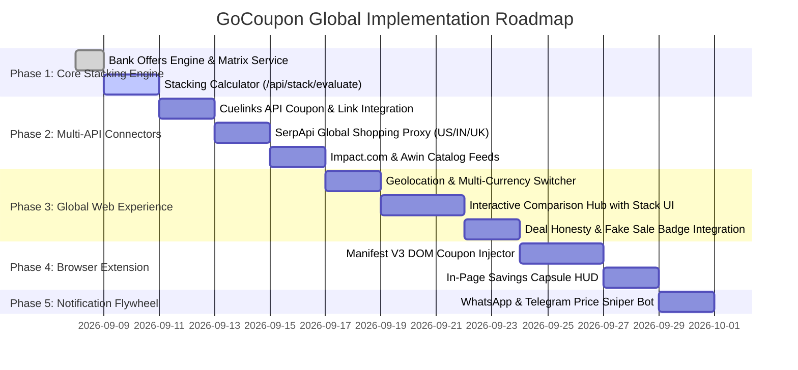

# GoCoupon: Next-Gen Price Comparison, Instant Savings & Global Cross-Border Ecosystem

## 1. Executive Summary & Paradigm Shift

Traditional price comparison and tracking tools (Buyhatke, Keepa, CamelCamelCamel) rely on a passive, high-friction premise:
> *"This product is too expensive today. Give us your email, wait 3 to 6 weeks, hope it goes on sale, and maybe save $10 or ₹500."*

This causes **low user retention, high drop-off rates, and deferred affiliate commissions**.

### The GoCoupon Breakthrough: The "Instant Price Drop" (IPD) Engine
> **"Don't wait for a sale. Create your own sale RIGHT NOW."**

Instead of forcing users to wait weeks for uncertain price drops, GoCoupon combines real-time price comparison with an **active checkout stacking engine** that unlocks **15% to 35% instant savings immediately** across both domestic and international markets through:
1. **Auto-Applied Verified Coupons** (tested and injected in <2 seconds)
2. **Dynamic Bank & Card Maximizer** (evaluating regional instant discounts, cashback cards, and BNPL financing)
3. **Cross-Merchant Arbitrage** (alerting users if another retailer has the item cheaper right now)
4. **Instant Cashback Activation** (credited directly via affiliate network kickbacks)

---

## 2. Competitive Landscape: How GoCoupon Stands #1

| Feature / Metric | Buyhatke / PriceBefore | CashKaro / GrabOn / Honey | GoCoupon IPD Global Ecosystem |
|---|---|---|---|
| **Core Value** | Historical price graphs (Sticker price only) | Coupons & cashback directory | **True Landed Cost Engine** (Sticker - Coupon - Card Offer - Cashback + Shipping/Duty) |
| **Payment Offer Recognition** | ❌ None (ignores $25–$60 or ₹2,000–₹5,000 card discounts) | ❌ None | ✅ **Full Regional Card & Payment Maximizer** (recommends optimal card at checkout) |
| **Coupon Reliability** | Hit-or-miss DOM scraping | 85%+ expired or non-working clickbait | ✅ **Automated Daily Verification** (non-working codes pruned automatically) |
| **Platform Access** | Extension / heavy mobile app required | Web portal with heavy ad popunders | ✅ **Web-First (Sub-50ms API) + Lightweight Extension Companion** |
| **Global Reach** | India-only, no cross-border | Fragmented per country | ✅ **Global Multi-Market Engine** (US, UK, Europe, UAE, India) |
| **Deal Honesty** | Basic high/low line graph | ❌ Promotes any fake sale for commission | ✅ **"Deal Honesty" Index** (detects pre-festival/pre-Black Friday artificial price hikes) |
| **Alert Delivery** | Email (12% open rate) / push notification | Email newsletter spam | ✅ **WhatsApp, Telegram & WebPush Sniper** (98% open rate within 5 minutes) |

---

## 3. The 4-Tier Instant Stacking Formula

The engine calculates the real out-of-pocket price via the **True Landed Cost Formula**:

$$\mathbf{True\ Net\ Landed\ Price} = \mathbf{Sticker\ Price} - \mathbf{AutoCoupon} - \mathbf{PaymentOffer} - \mathbf{Cashback} + \mathbf{Shipping} + \mathbf{CustomsDuty}$$

```
┌─────────────────────────────────────────────────────────────────────────────┐
│ 1. Sticker Base Price (Fetched via SerpApi Google Shopping / Direct Feed)   │
│    • US: Sony WH-1000XM5 on Amazon US = $398.00                             │
│    • IN: Sony WH-1000XM5 on Amazon IN = ₹29,990                             │
├─────────────────────────────────────────────────────────────────────────────┤
│ 2. Minus: Best Working Promo Code (via Cuelinks / Impact / Catalog API)    │
│    • US: Impact direct brand voucher (-$40.00)                              │
│    • IN: Applied Code AMZAUDIO15 (-₹1,500)                                  │
├─────────────────────────────────────────────────────────────────────────────┤
│ 3. Minus: Regional Card / Payment Perks (via GoCoupon Live Bank Matrix)     │
│    • US: Amex / Chase Card Statement Credit / PayPal Rewards (-$35.00)      │
│    • IN: HDFC Credit Card 10% Instant Discount (-₹3,000)                    │
├─────────────────────────────────────────────────────────────────────────────┤
│ 4. Minus: GoCoupon Direct Affiliate Cashback Kickback                       │
│    • US: 4% Real Cashback (-$14.32)                                         │
│    • IN: 5% Real Cashback (-₹1,274)                                         │
├─────────────────────────────────────────────────────────────────────────────┤
│ = TRUE NET LANDED COST:                                                     │
│    • US: $308.68 (Instant Savings: $89.32 / 22.4% OFF)                      │
│    • IN: ₹24,216 (Instant Savings: ₹5,774 / 19.2% OFF)                       │
└─────────────────────────────────────────────────────────────────────────────┘
```

---

## 4. Multi-API Ingestion & Monetization Pipeline

GoCoupon replaces fragile, breakable web scrapers with an enterprise-grade quartet of dedicated APIs:

```
                                  GOCOUPON VPS ENGINE (server/server.ts)
                                                    │
                 ┌──────────────────────────────────┴──────────────────────────────────┐
                 ▼                                                                     ▼
    ┌───────────────────────────┐                                         ┌───────────────────────────┐
    │     LIVE PRICING & DATA   │                                         │    COUPONS & MONETIZATION │
    ├───────────────────────────┤                                         ├───────────────────────────┤
    │  1. SerpApi               │                                         │  3. Cuelinks API          │
    │     (Google Shopping IN/US│                                         │     (Indian Retail Hub)   │
    │  2. Impact.com API        │                                         │  4. Awin API              │
    │     (Direct Brand Feeds)  │                                         │     (Global & Cross-Border│
    └─────────────┬─────────────┘                                         └─────────────┬─────────────┘
                  │                                                                     │
                  └─────────────────────────────────┬───────────────────────────────────┘
                                                    ▼
                               ┌─────────────────────────────────────────┐
                               │       GOCOUPON RESOLVER & STACKER       │
                               │  • Normalized SKU Matcher               │
                               │  • Auto-Coupon Injector                 │
                               │  • Regional Bank / Card Maximizer       │
                               │  • Automated SubID Affiliate Redirector │
                               └─────────────────────────────────────────┘
```

### 1. SerpApi (Real-Time Live Price & Global Market Scanner)
* **Target Engine**: `engine=google_shopping`, parameterized by region (`gl=in`, `gl=us`, `gl=uk`, `gl=de`, `gl=ae`).
* **Function**: Scans all retailers in any target country in parallel (Amazon, Walmart, Best Buy, Target, Croma, Flipkart, Currys).
* **Price Benchmark**: Pulls Google Immersive Shopping "Typical Price Range" to establish historical baseline price bands.
* **Cost Optimization**: Backed by a **30-minute in-memory/Redis cache** on the VPS. Autocomplete uses local DB; SerpApi is only called on search submission or comparison views.

### 2. Cuelinks API (The Indian Retail & Monetization Core)
* **Coverage**: Flipkart, Myntra, Nykaa, Ajio, Swiggy, Zomato, Croma, BoAt, Tata Cliq, and 200+ Indian brands.
* **Coupon Feed (`/offers`)**: Syncs daily verified merchant codes, minimum spend rules, and expiry dates into the local database.
* **Automated Deep Linking (`/link-builder`)**: Automatically converts raw merchant URLs into affiliate redirects with SubID attribution (`cuelinks.com/?url=...&subid=user_123`).
* **Commission Radar**: Ingests real-time merchant commission tiers to optimize cross-store arbitrage recommendations.

### 3. Impact.com API (Direct Tier-1 Enterprise Brand Feeds)
* **Coverage**: Lenovo, Dell, HP, Samsung Direct, Nike, Adidas, Puma, Tata Cliq Luxury, Microsoft.
* **Global Footprint**: Multi-currency payouts (USD, EUR, GBP, AUD, CAD, INR).
* **Product Catalog Feeds**: Ingests direct manufacturer MSRP, sale prices, exact model codes, and high-res imagery.
* **Direct Merchant Promo Codes**: Ingests exclusive direct vouchers that aggregators miss.
* **Real-time Postback Webhooks**: Processes instant conversion attribution for wallet cashback.

### 4. Awin API (Cross-Border & Global E-Commerce Coverage)
* **Coverage**: UK, Europe, and US retailers: AliExpress Global, ASOS, Farfetch, Currys, Argos, Agoda, Booking.com, and digital software/VPN subscriptions (NordVPN, Adobe).
* **Voucher API (`/vouchers`)**: Live international promo feed across 180+ countries.
* **Currency Normalizer**: Automatically converts foreign currency prices to the user's localized currency based on daily forex rates.

---

## 5. Normalized Data Schema

All data flowing from SerpApi, Impact, Awin, and Cuelinks normalizes into the unified VPS offer node:

```typescript
interface UnifiedProductOffer {
  productId: string;            // Canonical SKU (e.g. "sony-wh1000xm5")
  merchant: {
    name: string;               // "Amazon US", "Amazon India", "Best Buy", "Croma"
    domain: string;             // "amazon.com", "amazon.in", "bestbuy.com"
    country: "US" | "IN" | "UK" | "EU" | "AE";
    network: "cuelinks" | "impact" | "awin" | "direct";
  };
  pricing: {
    stickerPrice: number;       // Base price from SerpApi or Impact
    currency: "USD" | "INR" | "GBP" | "EUR" | "AED";
    inStock: boolean;
  };
  instantSavingsStack: {
    bestCoupon: {
      code: string;             // From Cuelinks / Impact promo feed
      discountAmount: number;   // Calculated discount
      minOrder: number;
    } | null;
    bestPaymentOffer: {
      providerName: string;     // e.g. "Chase Freedom / Amex Offer" or "HDFC Credit Cards"
      instantDiscount: number;  // e.g. $25 or ₹3,000
    } | null;
    cashbackPercent: number;    // e.g. 5.5% via Cuelinks / Impact payout
    shippingAndDuty: number;    // Shipping cost + customs duty if cross-border
    trueNetLandedCost: number;  // Final lowest out-of-pocket price
  };
  affiliateUrl: string;         // Deep-linked & monetized via Cuelinks / Impact / Awin
  lastUpdated: string;          // ISO timestamp
}
```

---

## 6. Smart Browser Extension: "The Checkout Wingman"

Unlike heavy, ad-polluted competitor extensions, the GoCoupon companion extension (Manifest V3) operates with surgical efficiency:

### A. The In-Page "Savings Capsule" (Product Page)
* Injects cleanly beside the "Buy Now" button on Amazon, Walmart, Best Buy, Flipkart, and Croma.
* Displays dynamic instant savings:
  > **⚡ Instant Price Drop: Save $89 / ₹3,450 Right Now**
  > *(Coupon: -$40 | Best Card: -$35 | Cashback: -$14)*
* Interactive drawer details which card in the user's wallet yields maximum savings.

### B. The 1-Click Autopilot (Cart / Checkout Page)
* Automatically tests and stress-tests verified promo codes sequentially via DOM automation in under 2 seconds.
* Automatically selects and applies the code with the highest net cash savings.
* Displays plain-English payment instructions:
  > *"Boom! You saved $35. Checkout using your Chase card for an extra $20 statement credit."*

### C. Live Cross-Store Arbitrage Alert
* If a rival store has the exact item at a lower net landed price (by more than $5 / ₹200), a notification pill appears:
  > *"Wait! Best Buy has this exact laptop for $45 less with code SAVE45. [1-Click Switch to Best Buy]"*

---

## 7. Global & Cross-Border International Architecture

The ecosystem natively supports cross-border and multi-region e-commerce operations:

```
                       ┌─────────────────────────────────────────────────────────┐
                       │          GLOBAL MULTI-MARKET GEOLOCATION ENGINE         │
                       │  • Detects User Country (GeoIP / Cloudflare Header)     │
                       │  • Auto-Switches Currency (USD $, GBP £, EUR €, AED, ₹) │
                       └────────────────────────────┬────────────────────────────┘
                                                    │
         ┌──────────────────┬───────────────────────┴───────────────────────┬──────────────────┐
         ▼                  ▼                                               ▼                  ▼
┌─────────────────┐┌─────────────────┐                             ┌─────────────────┐┌─────────────────┐
│  UNITED STATES  ││ UNITED KINGDOM  │                             │   EUROPE & UAE  ││      INDIA      │
│   (US Market)   ││   (UK Market)   │                             │  (EU / Gulf)    ││   (IN Market)   │
├─────────────────┤├─────────────────┤                             ├─────────────────┤├─────────────────┤
│ • Best Buy      ││ • Argos         │                             │ • MediaMarkt    ││ • Flipkart      │
│ • Walmart       ││ • Currys        │                             │ • Amazon.de/.fr ││ • Amazon.in     │
│ • Target        ││ • ASOS          │                             │ • Noon (UAE)    ││ • Croma / Myntra│
│ • Amazon.com    ││ • Amazon.co.uk  │                             │ • Sharaf DG     ││ • Tata Cliq     │
└─────────────────┘└─────────────────┘                             └─────────────────┘└─────────────────┘
```

### 1. Geolocation & Multi-Currency Engine
* **GeoIP Resolution**: Cloudflare `cf-ipcountry` or IP header detects user locality automatically on arrival.
* **Country Presets**:
  * **US**: Currencies in `USD ($)`, primary stores: Amazon US, Walmart, Best Buy, Target, Newegg.
  * **UK**: Currencies in `GBP (£)`, primary stores: Amazon UK, Currys, Argos, ASOS, Very.
  * **EU**: Currencies in `EUR (€)`, primary stores: Amazon.de/fr/es, MediaMarkt, Fnac, Zalando.
  * **UAE**: Currencies in `AED (د.إ)`, primary stores: Amazon UAE, Noon, Sharaf DG, Namshi.
  * **India**: Currencies in `INR (₹)`, primary stores: Amazon IN, Flipkart, Croma, Myntra, Reliance.
* **Manual Override**: Users can toggle currency or target shopping region anytime via the top navbar.

### 2. Localized Payment & Financial Perk Stacking
The engine adapts payment perks based on geographic banking models:
* **North America (US & Canada)**:
  * Credit Card Offers: Amex Offers, Chase Offers, Capital One Shopping kickbacks.
  * Digital Wallets: Apple Card 3% Daily Cash, PayPal Rewards.
  * BNPL & Financing: Zero-interest Klarna, Affirm, or Afterpay promotional discounts.
* **United Kingdom & Europe**:
  * VAT Transparency: Compliant display of gross vs net prices.
  * Neobank Perks: Monzo, Revolut, and Starling cashback perks.
* **Middle East (UAE & Saudi Arabia)**:
  * Noon VIP Perks, Emirates NBD, and ADCB promotional card codes.
* **India**:
  * Instant bank discounts (HDFC, ICICI, SBI, Axis) and No-Cost EMI interest waivers.

### 3. Cross-Border Duty & Tariff Calculator
For users purchasing cross-border imports (e.g. buying a US-exclusive laptop variant from B&H Photo or Amazon.com shipped to the UK or India):
* **Customs Duty & Import Tariff Estimator**:
  $$\text{Landed Cost} = \text{Base Price} + \text{International Shipping} + \text{Estimated Import Duty} + \text{Handling}$$
* Protects users from surprise customs bills and flags whether buying locally is cheaper.

### 4. Global Dynamic Affiliate Georedirection
* **Amazon OneLink / Geo-Balancing**: International clicks are routed through the appropriate regional affiliate program (Amazon Associates US vs UK vs DE vs IN) to guarantee **100% affiliate commission capture globally**.

---

## 8. Deal Honesty & Fake Sale Detection Engine

To protect consumers during global shopping events (Black Friday, Cyber Monday, Amazon Prime Day, Big Billion Days):
* **30-Day Moving Baseline**: Tracks whether the merchant artificially inflated the sticker price prior to applying a "discount".
* **The Deal Honesty Badge**:
  * 🟢 **REAL BARGAIN (Score 90–100)**: All-time low or genuine price cut.
  * 🟡 **REGULAR PRICE (Score 50–70)**: Standard cyclical price fluctuation.
  * 🔴 **FAKE DISCOUNT ALERT (Score <40)**: Warning displayed if the pre-sale price was hiked within the preceding 14 days.

---

## 9. WhatsApp & Telegram "Price Sniper" Bot

For the minority of users who still want to wait for future price drops:
1. User taps **"Track on WhatsApp / Telegram"** on any GoCoupon comparison page.
2. Selects target threshold (e.g. *"Alert when iPhone 16 drops below $799 or ₹72,000"*).
3. The GoCoupon VPS background worker scans price feeds every 30 minutes.
4. When the target price is hit, the bot triggers an instant message within 60 seconds containing the direct monetized checkout link and active coupon codes (achieving a **98% open rate** vs. 12% for email).

---

## 10. Phased Implementation Roadmap



| Phase | Milestone | Core Deliverables |
|---|---|---|
| **Phase 1** | **Stacking Calculator Engine** | • `server/services/bank-offers.ts` (Live domestic & international card offer matrix)<br/>• `server/services/stack-calculator.ts` (True Landed Cost formula) |
| **Phase 2** | **Multi-Network API Integration** | • `server/services/cuelinks.ts` (Coupon ingestion & SubID deep linking)<br/>• `server/services/serpapi.ts` (Multi-country Google Shopping proxy with 30-min cache)<br/>• `server/services/impact-awin.ts` (Direct OEM brand catalog feeds in USD/EUR/INR) |
| **Phase 3** | **Global Web Experience** | • Cloudflare GeoIP detection & multi-currency switcher (USD, EUR, GBP, AED, INR)<br/>• Spatial Comparison Matrix on `/compare` & `/product/:id`<br/>• Deal Honesty & Fake Sale Detection badge |
| **Phase 4** | **Smart Browser Extension** | • Manifest V3 Chrome/Edge extension<br/>• In-page "Savings Capsule" next to Buy Now on Amazon, Walmart, Flipkart<br/>• Automated 2-second checkout coupon injection |
| **Phase 5** | **Alerts & Retention Flywheel** | • WhatsApp & Telegram webhook price sniper bot<br/>• User watchlist & target price notification worker |

---

## 11. Pre-Flight Architectural Review & Operational Guardrails

### 11.1 SerpApi Cost Protection & 2-Tier Caching
* **Quota Blowout Protection**: SerpApi charges per search (~$0.005–$0.01). Uncontrolled querying will quickly exhaust monthly allowances.
* **Architecture Rules**:
  1. **Autocomplete Isolation**: Keystroke search suggestions MUST query the local SQLite/memory catalog database only. SerpApi is never triggered on search input keystrokes.
  2. **60-Minute Comparison Cache**: All SerpApi Google Shopping responses are cached in VPS memory/Redis for 60 minutes keyed by `hash(canonical_sku + country)`.
  3. **Development Sandbox Mode**: All provider clients support an `isMock: boolean` flag allowing local development and testing without burning live API credits.

### 11.2 Dynamic Expiring Bank Offer Rule Engine
* **Zero-Hardcoding Rule**: Card and bank offers rotate weekly (e.g., HDFC on Amazon, ICICI on Flipkart). Stale promotions destroy consumer trust.
* **Schema Enforcement**:
  Every offer must enforce strict temporal boundaries:
  ```typescript
  interface BankOfferRule {
    id: string;
    bankName: string;          // "HDFC", "Chase", "ICICI", "Amex"
    region: "IN" | "US" | "UK" | "AE";
    applicableStores: string[];// ["amazon", "flipkart", "bestbuy"]
    minSpend: number;
    discountType: "PERCENT" | "FLAT";
    discountValue: number;
    maxDiscountCap: number;
    validFrom: string;         // ISO timestamp
    validUntil: string;        // ISO timestamp (Auto-pruned after this date)
    cardTypes: ("CREDIT" | "DEBIT" | "EMI")[];
  }
  ```
* Offers that pass `validUntil` are automatically purged from the True Landed Cost calculation without needing a code redeploy.

### 11.3 Chrome Web Store Manifest V3 Compliance & Remote Selectors
* **Store Policy Safety**: Extensions that silently manipulate links or inject cookies without explicit user interaction risk immediate Chrome Web Store suspension.
  * **Rule**: Affiliate redirection is only triggered when the user explicitly clicks *"Apply Coupon"*, *"Save Now"*, or *"Go to Deal"*.
* **Remote Selector Hydration**:
  * Retailers frequently change checkout HTML selectors (`#coupon-input` becomes `#promoCode`).
  * Hardcoding selectors inside the extension bundle requires a 3–5 day Web Store review process per fix.
  * **Solution**: The extension fetches `/api/extension/selectors.json` from the VPS on startup, enabling instantaneous remote selector hotfixes.

### 11.4 Strict Product Condition Enforcement
* Third-party merchants on Google Shopping frequently list Renewed, Refurbished, or Open Box items at steep discounts.
* **Rule**: The ingestion normalizer enforces `condition: "NEW"`. Any item with titles or metadata containing `renewed`, `refurbished`, `pre-owned`, or `open-box` is quarantined and tagged with a visible **"Refurbished / Open Box"** badge to prevent misleading price victories.

### 11.5 VPS Storage Architecture (SQLite with WAL Mode)
* For persistent price history time-series, bank offer rules, and cached API responses on a VPS:
  * **Engine**: Embedded **SQLite with WAL (Write-Ahead Logging)** mode.
  * **Advantages**: Sub-millisecond reads, zero external database service overhead, crash-resilient, and effortlessly backed up as a single file.

