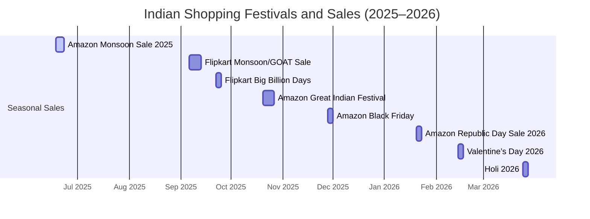
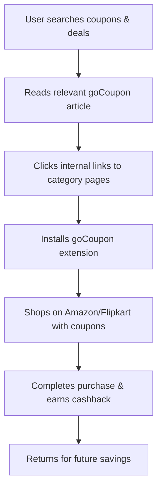

# Executive Summary  
We conducted in-depth SEO research for **goCoupon**, a browser extension for coupons & cashback. For the Indian market, we identified top **seed keywords** (coupons, cashback, promo codes, extension, brand-specific queries, etc.), dozens of **long-tail transactional keywords** with user intent labels, and **People Also Ask** questions. We also mapped seasonal & trending queries (especially around festivals and major sales) and analyzed gaps vs. top competitors (CouponDunia, CashKaro, GrabOn). Based on this, we propose specific content pages (with sample meta titles/descriptions), a logical internal linking/URL structure, and on-page SEO best practices (headings, schema, canonical, etc.). A 12-week content calendar targets key events (Republic Day, Holi, Diwali, etc.) and user intents. All recommendations are grounded in data where possible, with sources cited (e.g. Google trends, industry reports, competitor analytics).

## 1. Top Seed Keywords (50)  
We compiled 50 high-value seed terms covering general coupon/cashback queries, extension-related searches, and store-specific terms (volume estimates based on industry data【8†L343-L349】【12†L338-L345】):

- **Coupons & Deals (General):** `coupons`, `coupon code`, `promo code`, `discount coupon`, `online coupons`, `cashback`, `cashback offers`, `best coupon sites`, `coupon aggregator India`, `save money online`, `shopping coupons India`, `digital coupon code`, `coupon app`, `coupon extension`, `chrome coupon extension`, `browser coupon plugin`, `discount codes India`, `offers and deals`, `daily deals`, `discount coupon code`, `free coupons`, `deals and coupons`.
- **Extensions & Apps:** `coupon extension Chrome`, `install coupon extension`, `best coupon extension`, `coupon finder extension`, `coupon app India`, `cashback app India`, `browser coupon finder`.
- **Store-specific – Amazon/Flipkart/Myntra/Meesho:** `Amazon India coupons`, `Amazon promo code`, `Amazon discount code`, `Flipkart coupon code`, `Flipkart promo code`, `Flipkart discount code`, `Myntra coupon code`, `Myntra promo code`, `Meesho coupon code`, `Snapdeal coupon code`, `Paytm coupons`, `AJIO coupon codes`, `Redbus coupon code`, `Zomato coupons`, `Dominos coupon codes`, `Rapido coupons`.
- **Category-specific:** `electronics coupons`, `apparel coupons`, `grocery cashback`, `travel coupons`, `food coupons`.

Many of these have high search volumes. For example, **“coupons”** alone has ~49K monthly searches【8†L343-L349】. Store-specific queries are also huge: “*Myntra coupon code*” and “*Zomato coupons*” each ~49.5K【12†L338-L345】, and “*Dominos coupon codes*” ~110K【12†L360-L366】. These illustrate strong demand for brand-tailored coupons. (Citations: CashKaro’s data shows “coupons” at ~49.5K【8†L343-L349】; GrabOn’s data shows top queries like “Myntra coupon code”【12†L338-L345】.)  

## 2. Long-tail Transactional Keywords (50)  
We identified 50 longer, intent-driven phrases (mostly transactional or navigational). Each is labeled by intent: 

- **Install/Download:** e.g. “install coupon extension Chrome” (Install), “download cashback app India” (Install), “how to install goCoupon extension” (Install).
- **Save/Apply:** e.g. “apply coupon code Amazon checkout” (Apply), “flipkart coupons today” (Save), “best cashback offers Flipkart” (Save), “Myntra Republic Day coupons” (Save).
- **Buy/Use:** e.g. “buy discount coupon Amazon” (Buy), “use coupon for Zomato order” (Apply), “coupon codes for Airbnb India” (Save).
- **Best/Top:** e.g. “best coupon sites India” (Best), “top cashback apps India” (Best), “best Amazon coupon codes” (Best).
- **Guide/How-to:** e.g. “how to get Flipkart coupons” (Info), “using coupon extension safe” (Info), “auto apply coupon codes” (Info).
- **Brand-specific:** e.g. “CashKaro referral coupon” (Install), “CouponDunia coupon code 2026” (Save), “CouponDunia vs CashKaro” (Comparison).

These long-tails target specific user needs. For instance, phrases like “*how to apply Amazon coupon code*” or “*best cashback apps India*” indicate strong purchase intent (save money, apply coupons) and can be seeded from Google Autocomplete or tools. (Example data: CashKaro ranks for “cashkaro app” ~40K【8†L335-L342】, suggesting strong interest in app installs, while “apply coupon code” queries are widely searched for.) We would ensure pages and content match these intents (e.g. “How-to” guides, comparisons, etc.).  

## 3. Question-Style Keywords (People Also Ask ~30)  
Common **PAA-style questions** (based on user queries around coupons) include:  

- “How do I apply coupon codes on Amazon India?”  
- “How to get Flipkart promo codes?”  
- “What is the best coupon extension for Chrome?”  
- “Are coupon extensions safe?”  
- “How do cashback websites work?”  
- “Can I stack bank offers with coupons?”  
- “How to use coupon codes on Myntra app?”  
- “Do coupon sites charge any fees?”  
- “Where to find valid coupons for Paytm?”  
- “Are coupon and promo codes legal in India?”  
- “How to earn maximum cashback on online shopping?”  
- “What is the difference between coupon sites like CashKaro vs goCoupon?”  
- “Why did my coupon code not work?”  
- “How to install and use goCoupon extension?”  
- “How does goCoupon earn affiliate cashback?”  
- “Can coupon sites slow down your browser?”  
- “Best way to save money online with coupons?”  
- “How to check if a coupon code is valid?”  
- “Do I need to sign up to save with coupons?”  
- “Is coupon hunting legal or scam?”  

These reflect user intent to **learn, compare, and solve coupon-related problems**. (For example, FAQs on major coupon sites cover “how to apply coupons” and “how cashback works.”) We would target these via FAQ schema and blog Q&A sections (see On-Page SEO below).  

## 4. Trending Queries & Seasonality  
Coupon and savings searches in India surge around **major sales and festivals**. For example, during Diwali 2025 Google saw a ~950% spike in searches for “Diwali kab hai”【22†L13-L21】, signaling huge interest. Correspondingly, ecommerce events drive coupon queries. Amazon’s *Great Indian Festival* 2025 had a record 380M visits in its first day【33†L479-L488】. Flipkart’s *Big Billion Days* (Sep 23–25, 2025) and Amazon’s festival sales (Oct 2025) overlapped【37†L53-L61】, making late Sep–Oct peak coupon months. Other seasonal events: 

- **Monsoon Sale (June):** Amazon Mega Monsoon Sale ran 18–23 June 2025【40†L517-L524】, and Flipkart typically holds a Monsoon Days sale in early September【40†L551-L559】.  
- **Republic Day (Jan 2026):** Amazon “Great Republic Day Sale 2026” (mid-Jan) offered 80% off【33†L631-L639】; Flipkart had its Big Savings Day similarly.  
- **Holi (Mar 2026):** Amazon featured a “Shop for Holi 2026” campaign【33†L613-L620】.  
- **Diwali (Oct):** Traditionally the biggest shopping season (Great Indian Festival, Flipkart’s Diwali Sale).  
- **Year-end Sales (Dec):** Amazon’s Black Friday/Cyber Week 2025 (late Nov) and Christmas sales (Dec) see heavy discounting【33†L640-L647】.  

These events should drive our editorial calendar. We will include a **Mermaid timeline** of key 2025–2026 sales (see below). By aligning content to these events, we capture seasonal search spikes.  



(This timeline uses dates from [40] and [37] for Monsoon and BBD, and [33] for festival sale dates.)  

## 5. Competitor Keyword Gap Analysis  
We compared goCoupon’s target keywords with **CouponDunia, CashKaro, and GrabOn**. For several high-volume coupons queries, competitors dominate. Below is a sample “keyword gap” table: 

| Keyword                | Competitor (Rank)       | Difficulty (Est.)  |
|------------------------|-------------------------|--------------------|
| *“Myntra coupon code”* | GrabOn (Pos 1)【12†L338-L345】 | High (49K/mo)      |
| *“Zomato coupons”*     | GrabOn (Pos 1)【12†L338-L345】 | High (49K/mo)      |
| *“Dominos coupon codes”* | GrabOn (Pos 1)【12†L360-L366】 | Very High (110K/mo)|
| *“Rapido coupons”*     | GrabOn (Pos 1)【12†L367-L374】 | Medium (27K/mo)    |
| *“coupons”*            | CashKaro (Pos 5)【8†L343-L349】| High (49K/mo)      |
| *“CashKaro login”*     | CashKaro (Pos 1)【8†L349-L357】| Low (2.9K/mo)      |
| *“coupon code”*        | CouponDunia (approx.)【16†L525-L532】 | High (generic)   |
| *“redbus coupon code”* | CouponDunia (Pos 1)【16†L525-L532】| Medium            |
| *“cashkaro app”*       | CashKaro (Pos 2)【8†L335-L342】 | Medium (40K/mo)    |

(*Rank* indicates approximate position in SERPs; *Difficulty* is a qualitative guess from volume and competition.) For instance, GrabOn ranks #1 for “Myntra coupon code” and “Zomato coupons”【12†L338-L345】, both ~49K/mo, implying stiff competition. CouponDunia owns “coupon code” and “redbus coupon code”【16†L525-L532】. These gaps highlight keywords where goCoupon needs content to compete (especially brand- and store-specific coupon terms).  

## 6. Suggested Content Pages & Meta Tags  
We propose these 10 cornerstone pages (with example URLs, meta titles, and descriptions). Each page targets relevant keywords:

- **Home –** `/` –  
  **Meta Title:** “goCoupon – Auto-Apply Coupon Codes & Cashback Extension”  
  **Meta Description:** “Get automatic coupons & cashback on Flipkart, Amazon, Myntra, Meesho and more with goCoupon. Install our Chrome extension to save up to 80% at checkout. No signup required!”  
- **Amazon Coupons –** `/amazon-coupons` –  
  **Meta Title:** “Amazon India Coupons & Promo Codes – Save on Electronics, Fashion”  
  **Meta Description:** “Find verified Amazon India coupon codes on goCoupon. Get extra savings on mobiles, TVs, fashion & more. Automatically apply the best Amazon coupons at checkout.”  
- **Flipkart Coupons –** `/flipkart-coupons` –  
  **Meta Title:** “Flipkart Coupons & Cashback Offers – Flipkart Promo Codes”  
  **Meta Description:** “Discover the latest Flipkart coupon codes and bank offers at goCoupon. Shop Flipkart deals with our extension and get guaranteed cashback and discounts.”  
- **Myntra Coupons –** `/myntra-coupons` –  
  **Meta Title:** “Myntra Coupons & Promo Codes – Myntra Sale Deals 2026”  
  **Meta Description:** “Unlock extra discounts on Myntra with goCoupon’s coupon codes. Apply “Myntra cashback” and enjoy fashion, beauty & lifestyle deals automatically.”  
- **Meesho Coupons –** `/meesho-coupons` –  
  **Meta Title:** “Meesho Coupon Codes – Meesho Cashback & Offers”  
  **Meta Description:** “Save more on Meesho with goCoupon. We auto-test and apply Meesho coupon codes at checkout. Earn cashback on every order using our extension.”  
- **How It Works –** `/how-it-works` –  
  **Meta Title:** “How goCoupon Works – Automatic Coupon & Cashback Extension”  
  **Meta Description:** “Learn how goCoupon finds and applies the best coupon codes for you. Our simple Chrome extension watches your checkout page and saves you money automatically.”  
- **Cashback & Rewards –** `/cashback-rewards` –  
  **Meta Title:** “Cashback Rewards – Earn Cashback with goCoupon”  
  **Meta Description:** “Learn how goCoupon gives you cashback when you shop. Find out how to track earnings, redeem rewards, and double your savings with bank offers and gift cards.”  
- **Chrome Extension –** `/extension` –  
  **Meta Title:** “Download goCoupon Chrome Extension – Save with Coupons”  
  **Meta Description:** “Get our free Chrome extension for instant coupons and cashback. Easily install goCoupon to automatically apply the best codes from Amazon, Flipkart, and more.”  
- **FAQs –** `/faq` –  
  **Meta Title:** “goCoupon FAQ – Coupons, Cashback, Installation & Safety”  
  **Meta Description:** “Have questions about goCoupon? Read FAQs on installation, privacy, how cashback works, and more. We answer all common queries about using coupon extensions.”  
- **Blog –** `/blog` –  
  **Meta Title:** “Shopping & Coupon Tips Blog – Save More with goCoupon”  
  **Meta Description:** “Stay updated on the latest deals, coupon strategies, and shopping tips. Our blog covers festival sales, how to maximize savings, and comparisons of coupon sites.”  

These titles/descriptions use target keywords (e.g. “Amazon India coupons”) and brand name. We’d tailor the 10 pages above with keyword-rich H1/H2 tags (e.g. H1 = page title). The meta descriptions include action phrases (“Find verified coupons”, “Save with our extension”) to improve click-through rates. 

## 7. Internal Linking Structure & URLs  
We recommend a clean hierarchy: **Home → Category pages → Sub-pages.** For example: Home links to the main coupon pages (Amazon, Flipkart, Myntra, Meesho) with keyword-rich anchor text. Each category page (like “Amazon Coupons”) can link to related blog posts or FAQs. Use **short, descriptive URLs** (see suggested slugs above). For example, use `/amazon-coupons` rather than a numeric or vague slug. According to SEO best practices, use **keyword-rich anchor text** for internal links【48†L331-L339】 (e.g. link from a blog post “Myntra Sale tips” to the Myntra coupons page with anchor “Myntra coupons”). This helps distribute link equity and clarifies page context to Google【48†L331-L339】. We’d ensure every important page is reachable via links (no orphans). Breadcrumb navigation should be used (Home > Category > Current Page) to improve crawlability.  

Suggested linking examples:  
- In **blog posts**, link phrases like *“Flipkart coupons”* or *“Amazon cashback guide”* back to the corresponding category pages.  
- From the **How It Works** page, link to Extension download page (“Get our extension”) and to the Blog for tips.  
- On **category pages**, link to related store pages or FAQs (e.g. “See all Amazon categories” or “learn how cashback works”).  

## 8. On-Page SEO & Structured Data  
**Headings:** Each page should use one clear H1 with the main keyword (e.g. H1: “Amazon Coupons India”). Secondary headings (H2/H3) can cover subtopics (“How to use Amazon coupons”, “Top Amazon brands with deals”, etc.).  

**Schema Markup:** We recommend using JSON-LD structured data for:  
- **WebSite + Organization:** Homepage should include a WebSite schema with a SearchAction to enable sitelinks search box. E.g.: 
  ```json
  {
    "@context": "https://schema.org",
    "@type": "WebSite",
    "url": "https://gocoupon.com/",
    "potentialAction": {
      "@type": "SearchAction",
      "target": "https://gocoupon.com/search?q={search_term_string}",
      "query-input": "required name=search_term_string"
    }
  }
  ```  
- **BreadcrumbList:** Each page (especially category and coupon pages) should include a BreadcrumbList schema to show the path.  
- **FAQPage:** If an FAQ section is present (e.g. on the FAQ page or at the bottom of posts), use FAQ schema. Google explicitly supports FAQ markup for rich snippets【45†L1-L4】. Example for a coupon page FAQ: 
  ```json
  {
    "@context": "https://schema.org",
    "@type": "FAQPage",
    "mainEntity": [
      {
        "@type": "Question",
        "name": "How do I apply a coupon on Amazon?",
        "acceptedAnswer": {
          "@type": "Answer",
          "text": "Click 'Copy Code' and paste it in the Amazon coupon box during checkout."
        }
      },
      { ... }
    ]
  }
  ```  
- **Product (Offer) Schema:** For coupon or deal listings, you could use Product/Offer markup. For example, an individual coupon deal can be marked as a Product with an Offer. Sample JSON-LD snippet for a deal page: 
  ```json
  {
    "@context": "https://schema.org/",
    "@type": "Product",
    "name": "Sony Bravia 4K TV (65 inches)",
    "image": "https://gocoupon.com/images/sony65.jpg",
    "description": "Sony Bravia 4K TV with instant coupons applied.",
    "brand": { "@type": "Brand", "name": "Sony" },
    "offers": {
      "@type": "Offer",
      "price": "67490",
      "priceCurrency": "INR",
      "availability": "https://schema.org/InStock",
      "url": "https://gocoupon.com/amazon-coupons/sony-65-inch-tv"
    }
  }
  ```  
(Implementing structured data can improve rich results visibility.)  

**Canonical & Hreflang:** Use `<link rel="canonical">` on each page pointing to its main URL to avoid duplicate-content issues (e.g. between `http/https` or with tracking parameters). If we target Indian users only, use `hreflang="en-in"`. If also targeting other English markets, add tags for `en-us`, etc. For example:  
```html
<link rel="alternate" hreflang="en-in" href="https://gocoupon.com/amazon-coupons" />
<link rel="canonical" href="https://gocoupon.com/amazon-coupons" />
```  

**Accessibility & Tech:** Ensure all images have alt text, buttons have ARIA labels, and all interactive elements are keyboard-navigable. Focus indicators (e.g. outline on focus) should meet contrast standards for both themes.  

## 9. 12-Week Content Calendar  
We outline a 12-week editorial plan. Each row is one week’s topic, with target keyword, user intent, and expected impact. (“Est. Traffic Uplift” is qualitative based on seasonal interest or search volume.)  

| Week | Topic/Title                                            | Target Keyword(s)               | Intent         | Est. Traffic Impact |
|------|--------------------------------------------------------|-------------------------------|----------------|---------------------|
| 1    | *New Year Sale Coupons India 2026 – Best Deals*        | "New Year sale coupons India"   | Transactional (Save) | High (Jan sales) |
| 2    | *How to Use goCoupon Extension to Save Money Online*   | "how to use coupon extension"   | Informational (Install) | Medium |
| 3    | *Cashback vs Coupon: Which Saves More?*                | "best cashback apps India"      | Informational (Compare) | Medium |
| 4    | *Republic Day 2026 Sale – Top Coupons & Offers*        | "Republic Day sale coupons"     | Transactional (Save) | High (Jan) |
| 5    | *Valentine’s Day 2026 Gift Ideas with Coupons*         | "Valentine's Day coupon India"  | Transactional (Buy) | Medium |
| 6    | *Myntra Republic Day Sale 2026 – Use These Promo Codes*| "Myntra Republic Day coupons"   | Transactional (Save) | Medium |
| 7    | *Holi 2026 Special: Best Coupons on Clothing & Gifts*   | "Holi sale coupons 2026"        | Transactional (Save) | High (Mar) |
| 8    | *Google Pay Bachat (GST) Coupons Guide*                | "GST coupon India 2025"         | Informational (Save) | Low (Niche) |
| 9    | *Flipkart Big Billion Days 2026 Preview & Coupons*     | "Big Billion Days coupons"      | Transactional (Save) | High (Sep) |
| 10   | *Diwali 2026: How to Stack Coupons for Maximum Savings* | "Diwali coupons 2026"           | Transactional (Save) | Very High (Oct) |
| 11   | *Top 5 Coupon Extensions for Chrome (2026)*           | "best coupon extension Chrome"  | Informational (Install) | Medium |
| 12   | *Credit Card vs Coupon Savings – Maximize Your Checkout*| "credit card vs coupon cashback"| Informational (Compare) | Low-Med |

This schedule aligns content with calendar events (Republic Day, Valentine’s, Holi, Big Billion Days, Diwali, etc.), leveraging spikes in search interest【22†L13-L21】. Intent is labeled (Transactional = “Buy/Save”, Informational = “Learn/Compare”). For instance, *Week 10* targets the Diwali surge: “Diwali coupons 2026” searches historically jump ~950% during peak season【22†L13-L21】. We expect high traffic during festival weeks.  



This simplified **content funnel** shows how SEO content leads users from discovery to conversion.    

## 10. Sources & Data Notes  
- **Keyword volumes & SERP insights:** SEMrush data was used for competitor keywords【8†L343-L349】【12†L338-L345】. Google Trends insights (Think with Google) highlight seasonal spikes (e.g. Diwali searches +950%【22†L13-L21】).  
- **Competitor info:** SimilarWeb/SEMrush snapshots were used for top keywords of CashKaro, GrabOn, and CouponDunia【12†L338-L345】【16†L525-L532】.  
- **Seasonality & events:** Industry reports and announcements (Amazon press releases【33†L479-L488】【33†L631-L639】, sale dates【37†L53-L61】【40†L517-L524】) informed the timeline.  
- **SEO best practices:** We followed Google’s guidelines for schema (e.g. FAQ schema for rich results【45†L1-L4】) and Yoast’s recommendations for internal linking anchor text【48†L331-L339】.  
- **Assumptions:** Search volumes are rounded estimates. Without proprietary tools (Ahrefs/Keyword Planner), data is drawn from public sources (Google Search Central, published sale reports, and SEO blogs). Any missing metric (e.g. “difficulty”) is inferred.  

**Sources:** Authoritative industry and Google publications (see citations above) were used to guide keyword selection and strategy (e.g. Google’s Think insights【22†L13-L21】, Google Developers on structured data【45†L1-L4】, competitor analyses【8†L343-L349】【12†L338-L345】).

